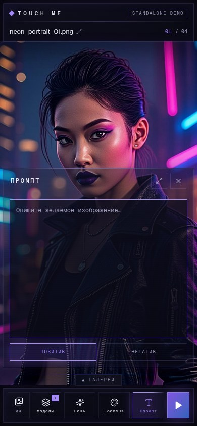
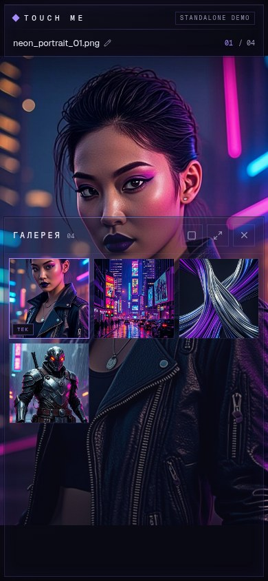

<div align="center">

# Touch me

**Mobile-first web UI для ComfyUI** — управление генерацией изображений
со смартфона: свайпы, жесты, полноэкранные панели, стеклянные поверхности.

Next.js 16 · TypeScript · Tailwind CSS 4 · Zustand

[](https://www.comfy.org/)
-f59e0b)

</div>

> **Статус — фаза 1: интерактивная оболочка.** Интерфейс полностью работает
> локально на демо-данных, но пока **не обращается к серверу ComfyUI** —
> слой интеграции (API + WebSocket) планируется фазой 2 (см. дорожную
> карту). Кнопка генерации честно сообщает, что API не подключён. Ничто не
> выдаётся за работающее, пока оно не работает.

**Quick start (English):** Node 20+ (or Bun 1.1+).

```bash
bun install        # or: npm install
bun run dev        # or: npm run dev
```

Open <http://localhost:3000> in a phone-sized viewport (390×844). No
environment variables needed for the demo. Full documentation below is
in Russian.

---

## О проекте

**Touch me** — вертикальный, заточенный под палец интерфейс для ComfyUI:
всё управление генерацией изображений со смартфона — свайпы, жесты,
полноэкранные панели, стеклянные поверхности. Проект создан как замена
настольному редактору нод для мобильного сценария: телефон → туннель к
ComfyUI (например, Colab + cloudflared) → готовые картинки в галерее.

Сейчас готова **фаза 1 — интерактивная оболочка**: интерфейс полностью
работает локально на демо-данных, но ещё не обращается к серверу ComfyUI
(слой интеграции — фаза 2, см. «Дорожную карту»).

## Скриншоты

<p align="center">
  
  
</p>
<p align="center">
  
  
</p>

## Честный статус фазы 1

Проект не считает кнопку «работающей» только потому, что она нарисована.
Фактическое состояние:

| Работает локально | Внешне готово, но пока без функции |
|---|---|
| Жесты: свайп-переключение, двойной тап (×2.2), pinch 1–8×, pan, тап — скрыть UI | Кнопка «Запустить генерацию» — тост-заглушка (API не подключён) |
| 9 панелей настроек: Модели, LoRA, Fooocus-стили, Промпт, Разрешение, KSampler, Режимы, Изображение, Upscale | Галерея — четыре демо-изображения с ручными метаданными |
| Сканер каталога моделей (`/api/models`, категории ComfyUI) + встроенный демо-набор имён, когда сканировать нечего | Режимы T2I / Img2Img / Upscale — меняют интерфейс, но пока не граф |
| 275 Fooocus-стилей с поиском и мультивыбором | Настройки Img2Img/Upscale хранятся, но никуда не отправляются |
| Переименование изображений, полноэкранная галерея | Прогресс генерации и живое превью (WebSocket) |
| Установка как кастом-нода ComfyUI (см. ниже) | Персистентность настроек — состояние сбрасывается перезагрузкой страницы |

## Установка в ComfyUI (custom_nodes)

Репозиторий одновременно является **web-only кастом-нодой**: корневой
`__init__.py` не добавляет нод в граф, а отдаёт собранный интерфейс из
каталога `web/` по адресу **`http://<адрес сервера>/mobile`** — с тем же
origin, что и сам ComfyUI.

```bash
cd /path/to/ComfyUI/custom_nodes
git clone https://github.com/<ваш-логин>/touch-me.git
# затем перезапустите ComfyUI
```

- Ничего устанавливать и собирать не нужно: `web/` уже содержит готовый
  статический бандл, нода не имеет зависимостей (`requirements.txt` не нужен).
- Откройте в браузере `http://127.0.0.1:8188/mobile` (при работе через
  туннель — `https://<ваш-туннель>/mobile`).
- Пересборка `web/` после правок исходников: `scripts/build_comfyui_web.sh`
  (только для разработки, нужны Node и `npm install`).

Что важно понимать: в этом режиме интерфейс работает на встроенных
демо-данных (панель «Модели» показывает встроенный список имён — без
весов). Подключение к реальным спискам и запуск генерации — фаза 2.
Маршруты кастом-ноды проверены офлайн-тестом
(`scripts/test_web_serve.py`), но в живом ComfyUI/Colab автор ещё не
запускал — см. «Проверено / не проверено».

## Быстрый старт (веб-разработка)

### Требования

- Node.js 20+ или Bun 1.1+
- Шелл с `cp` (Linux/macOS/Git Bash) для production-сборки

### Установка и запуск

```bash
bun install        # или: npm install
bun run dev        # или: npm run dev
```

Откройте <http://localhost:3000> — лучше в мобильном вьюпорте (390×844).
Production-сборка (standalone):

```bash
bun run build
bun run start      # или: npm run start
```

### Переменные окружения

Не обязательны. Для офлайн-демо можно указать каталог моделей реального
ComfyUI, чтобы панель «Модели» показала ваш список:

```bash
cp .env.example .env
# COMFYUI_MODELS_DIR=/path/to/ComfyUI/models
```

Если переменная не задана (или каталог пуст), панель показывает
встроенный демо-набор имён моделей — без весов, только для обозримости
интерфейса. Переменная `COMFYUI_SERVER_URL` предусмотрена на этап 2 —
сейчас интерфейс к серверу не обращается.

## Скрипты

| Команда | Действие |
|---|---|
| `bun run dev` | Dev-сервер на порту 3000 |
| `bun run lint` | ESLint |
| `bun run typecheck` | TypeScript (`tsc --noEmit`) |
| `bun run build` | Production-сборка (standalone) |
| `bun run start` | Запуск собранного standalone-сервера |
| `scripts/build_comfyui_web.sh` | Пересборка `web/` для кастом-ноды (bash) |
| `scripts/test_web_serve.py` | Офлайн-тест маршрутов `/mobile` (нужен aiohttp) |

## Структура проекта

```
├── __init__.py                # вход кастом-ноды ComfyUI (отдаёт web/ на /mobile)
├── web/                       # собранный статический бандл интерфейса (коммитится)
├── src/
│   ├── app/                   # layout, страница, /api/models (сканер моделей)
│   ├── components/touchme/    # оболочка, жесты, 9 панелей, галерея
│   ├── components/ui/        # используемые примитивы shadcn (select, slider, switch, toast)
│   ├── hooks/                 # use-toast
│   ├── lib/touchme/           # источники данных, типы, demo_models, fooocus_styles.json
│   └── store/touchme/         # три Zustand-стора (UI, галерея, генерация)
├── public/                    # логотип, demo-галерея
├── docs/                      # architecture.md, comfy-api.md, скриншоты
├── workflows/                 # сюда лягут API-шаблоны ComfyUI (этап 2)
├── scripts/                   # пересборка web/, офлайн-тест маршрутов
└── .github/workflows/ci.yml   # typecheck + lint + build на каждый push/PR
```

## Архитектура

Четыре слоя: компоненты UI → Zustand-сторы → источники данных (`sources.ts` —
единственная точка, откуда UI получает списки) → серверный сканер моделей.
Хранилище параметров генерации повторяет структуру нод ComfyUI (loaders /
loras / ksampler / upscale), поэтому интеграция сведётся к слою адаптера,
а не к переписыванию интерфейса.

Подробности: [`docs/architecture.md`](./docs/architecture.md),
контракт с ComfyUI API: [`docs/comfy-api.md`](./docs/comfy-api.md).

## Google Colab

Блокнот Colab ставит ComfyUI и запускает его за Cloudflare Tunnel; эта
нода подхватывается как обычный custom node и отдаёт мобильный интерфейс
на **`<ссылка-туннеля>/mobile`** — тот же экземпляр ComfyUI, тот же
туннель, отдельный маршрут:

| Интерфейс | Адрес |
|---|---|
| Classic ComfyUI | `https://<адрес>.trycloudflare.com` |
| Touch me Mobile | `https://<адрес>.trycloudflare.com/mobile` |

В блокноте за установку отвечает галочка `DOWNLOAD_MOBILE_UI`
(`Environment Setup`): включена — нода клонируется/обновляется в
`custom_nodes` и проверяется (файлы `__init__.py` и `web/index.html`,
маршрут `/mobile`); выключена — установка ComfyUI не меняется вовсе.
Повторные запуски не переклонировали репозиторий: при наличии `.git`
выполняется `git pull`.

## Дорожная карта

| Этап | Содержание |
|---|---|
| 1 | Слой подключения: ComfyApiClient, адрес сервера + clientId, списки из `/object_info`, персистентность localStorage |
| 2 | Шаблон workflow в API-формате + сквозной Text-to-Image: `/prompt` → `/ws` → `/history` → `/view` → галерея |
| 3 | Живое превью и управление очередью (прогресс, `/interrupt`) |
| 4 | Img2Img и Upscale (`/upload/image`, перенацеливание латента, denoise) |
| 5 | LoRA-цепочка с обходом, поле type для CLIP, стили в `easy stylesSelector` |
| 6 | Inpainting (мобильный редактор маски, `/upload/mask`) |
| 7 | Интеграция в Colab (custom nodes, туннель, E2E с телефона) |

## Проверено / не проверено

Проверено автором локально: `tsc --noEmit`, ESLint, production-сборка
Next.js, статический экспорт `web/`, офлайн-тест маршрутов кастом-ноды
(`scripts/test_web_serve.py`).

**Не проверено** в живом ComfyUI и Google Colab: реальная регистрация
маршрутов нодой, работа через туннель cloudflared, генерация изображений.
Утверждать обратное было бы нечестно.

## Сторонние ресурсы

`src/lib/touchme/data/fooocus_styles.json` — неизменённая копия ресурса из
[ComfyUI-Easy-Use](https://github.com/yolain/ComfyUI-Easy-Use) (GPL-3.0);
см. [`THIRD_PARTY_NOTICES.md`](./THIRD_PARTY_NOTICES.md).

## Лицензия

**Пока не выбрана — вопрос открыт.** Автор проекта не выбирал лицензию
без согласования: подберите её перед публикацией (учтите, что ресурс
Fooocus-стилей распространяется на условиях GPL-3.0 — см. уведомление о
сторонних ресурсах) и добавьте файл `LICENSE`.
