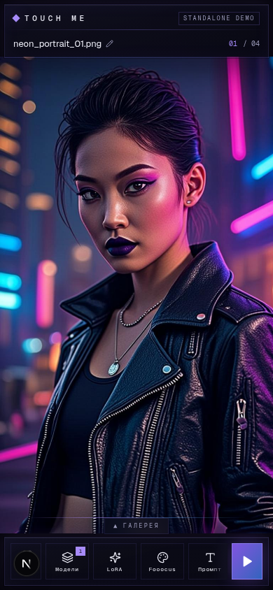
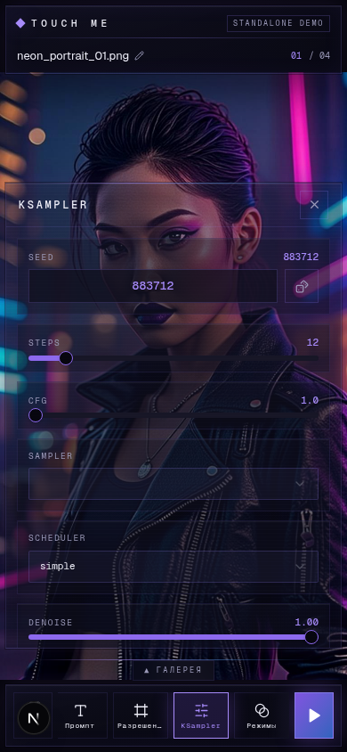

<div align="center">

# Touch me

**Mobile-first web UI для ComfyUI** — управление генерацией изображений
со смартфона: свайпы, жесты, полноэкранные панели, стеклянные поверхности.

Next.js 16 · TypeScript · Tailwind CSS 4 · Zustand

[](https://www.comfy.org/)
-4ade80)

</div>

> **Статус — фаза 2: живой API.** Интерфейс работает с реальным сервером
> ComfyUI: списки моделей/LoRA/сэмплеров — из `/object_info` (тот же
> источник, что у классического интерфейса; на Colab — папка моделей в
> Google Drive), генерация — через `POST /prompt` + WebSocket-прогресс,
> результаты — в галерее. Без сервера интерфейс честно деградирует в
> офлайн-демо.

**Quick start (English):** Node 20+ (or Bun 1.1+).

```bash
bun install        # or: npm install
bun run dev        # or: npm run dev
```

Open <http://localhost:3000> in a phone-sized viewport (390×844). No
environment variables needed. Full documentation below is in Russian.

---

## О проекте

**Touch me** — вертикальный, заточенный под палец интерфейс для ComfyUI:
всё управление генерацией изображений со смартфона — свайпы, жесты,
полноэкранные панели, стеклянные поверхности. Проект создан как замена
настольному редактору нод для мобильного сценария: телефон → туннель к
ComfyUI (например, Colab + cloudflared) → готовые картинки в галерее.

Фаза 1 была интерактивной оболочкой; фаза 2 подключила оболочку к живому
серверу: модель каждого блока берётся из своей категории папки моделей
сервера — ровно те же списки, что показывает классический интерфейс.

## Скриншоты

<p align="center">
  
  
</p>
<p align="center">
  
  
</p>

## Честный статус фазы 2

Проект не считает кнопку «работающей» только потому, что она нарисована.
Фактическое состояние (против живого ComfyUI, отдающего ноду на `/mobile`):

| Работает | Внешне готово, но пока без функции |
|---|---|
| Списки моделей/LoRA/сэмплеров/шедулеров/методов апскейла — из `/object_info` сервера; на Colab это файлы из Google Drive (My Drive/ComfyUI/models) — идентично оригинальному интерфейсу | Inpainting (мобильный редактор маски) |
| Полный Text-to-Image: сборка графа из блоков (Checkpoint/UNET/CLIP/VAE + цепочка LoRA) → `POST /prompt` → WebSocket-прогресс → результат в галерее | Управление очередью сервера (кроме прерывания — `/interrupt` работает) |
| Img2Img: файл с устройства или из галереи → `POST /upload/image` → `VAEEncode` → KSampler с denoise | Живое превью в реальном времени (бинарные кадры WS) |
| Upscale: латентный метод с множителем или реальная модель из `upscale_models` сервера | Персистентность настроек — состояние сбрасывается перезагрузкой страницы |
| Прогресс шагов сэмплера (строка статуса + прерывание), галерея наполняется историей сервера при подключении | Применение ControlNet (загрузчик выбирается, но в граф пока не включается — интерфейс предупреждает) |
| Индикатор соединения ОНЛАЙН/ОФЛАЙН в шапке; офлайн — демо-данные | |

## Установка в ComfyUI (custom_nodes)

Репозиторий одновременно является **web-only кастом-нодой**: корневой
`__init__.py` не добавляет нод в граф, а отдаёт собранный интерфейс из
каталога `web/` по адресу **`http://<адрес сервера>/mobile`** — с тем же
origin, что и сам ComfyUI (без CORS и mixed-content).

```bash
cd /path/to/ComfyUI/custom_nodes
git clone https://github.com/<ваш-логин>/touch-me.git
# затем перезапустите ComfyUI
```

- Ничего устанавливать и собирать не нужно: `web/` уже содержит готовый
  статический бандл, нода не имеет зависимостей (`requirements.txt` не нужен).
- Откройте в браузере `http://127.0.0.1:8188/mobile` (при работе через
  туннель — `https://<ваш-туннель>/mobile`).
- Пересборка `web/` после правок исходников: `bun run build:web`
  (только для разработки).

Что важно понимать: интерфейс общается с API того же origin — списки
моделей, генерация и галерея полностью живые. Если открыть страницу без
сервера (офлайн), она переключается на демо-данные и честно сообщает
«ОФЛАЙН · ДЕМО» в шапке. Маршруты кастом-ноды проверены офлайн-тестом
(`scripts/test_web_serve.py`), сборка — end-to-end на мок-сервере ComfyUI
(`scripts/test_mock_comfyui.py`).

## Быстрый старт (веб-разработка)

### Требования

- Node.js 20+ или Bun 1.1+

### Установка и запуск

```bash
bun install        # или: npm install
bun run dev        # или: npm run dev
```

Откройте <http://localhost:3000> — лучше в мобильном вьюпорте (390×844).
Сборка бандла для кастом-ноды:

```bash
bun run build:web   # = scripts/build_comfyui_web.sh → web/
```

### Переменные окружения

Не нужны: интерфейс всегда обращается к серверу, который его отдал
(тот же origin). `.env.example` оставлен как заготовка на случай
будущего отдельного хостинга.

## Скрипты

| Команда | Действие |
|---|---|
| `bun run dev` | Dev-сервер на порту 3000 |
| `bun run lint` | ESLint |
| `bun run typecheck` | TypeScript (`tsc --noEmit`) |
| `bun run build:web` | Пересборка `web/` для кастом-ноды (bash) |
| `scripts/test_web_serve.py` | Офлайн-тест маршрутов `/mobile` (нужен aiohttp) |
| `scripts/test_mock_comfyui.py` | E2E-тест: мок ComfyUI API + интерфейс (нужны aiohttp, playwright) |

## Структура проекта

```
├── __init__.py                # вход кастом-ноды ComfyUI (отдаёт web/ на /mobile)
├── web/                       # собранный статический бандл интерфейса (коммитится)
├── src/
│   ├── app/                   # layout, страница
│   ├── components/touchme/    # оболочка, жесты, 9 панелей, галерея
│   ├── components/ui/         # используемые примитивы shadcn (select, slider, switch, toast)
│   ├── hooks/                 # use-toast
│   ├── lib/touchme/           # api/ (клиент ComfyUI, сборка графа, история), данные, типы
│   └── store/touchme/         # четыре Zustand-стора (UI, соединение, галерея, генерация)
├── public/                    # логотип, demo-галерея
├── docs/                      # architecture.md, comfy-api.md, скриншоты
├── workflows/                 # будущие API-шаблоны ComfyUI
├── scripts/                   # пересборка web/, офлайн-тест маршрутов, мок-E2E
└── .github/workflows/ci.yml    # typecheck + lint + build:web на каждый push/PR
```

## Архитектура

Слои: компоненты UI → Zustand-сторы → слой API (`src/lib/touchme/api/`:
HTTP/WS-клиент, сборка графа из состояния, связка истории) → живой
ComfyUI. Хранилище параметров генерации повторяет структуру нод ComfyUI
(loaders / loras / ksampler / upscale), граф собирается напрямую из стора
стандартными нодами.

Подробности: [`docs/architecture.md`](./docs/architecture.md),
контракт с ComfyUI API: [`docs/comfy-api.md`](./docs/comfy-api.md).

## Google Colab

Блокнот Colab ставит ComfyUI и запускает его за Cloudflare Tunnel; эта
нода подхватывается как обычный custom node и отдаёт мобильный интерфейс
на **`<ссылка-туннеля>/mobile`** — тот же экземпляр ComfyUI, тот же
туннель, отдельный маршрут:

| Интерфейс | Адрес |
|---|---|
| Classic ComfyUI | `https://<адрес>.trycloudflare.com` |
| Touch me Mobile | `https://<адрес>.trycloudflare.com/mobile` |

Модели хранятся в Google Drive (`My Drive/ComfyUI/models`) — блокнот
монтирует Drive и ComfyUI работает с этой папкой напрямую, поэтому оба
интерфейса показывают одни и те же списки: checkpoint-блок — файлы из
`Drive/checkpoints`, LoRA-блок — из `Drive/loras`, и так далее по каждой
категории.

В блокноте за установку отвечает галочка `DOWNLOAD_MOBILE_UI`
(`Environment Setup`): включена — нода клонируется/обновляется в
`custom_nodes` и проверяется (файлы `__init__.py` и `web/index.html`,
маршрут `/mobile`); выключена — установка ComfyUI не меняется вовсе.
Повторные запуски не переклонировали репозиторий: при наличии `.git`
выполняется `git pull`.

## Дорожная карта

| Этап | Содержание |
|---|---|
| 1 | ~~Слой подключения: clientId, списки из `/object_info`~~ — готово (v0.3.0) |
| 2 | ~~Сквозной Text-to-Image: `/prompt` → `/ws` → результат в галерее~~ — готово (v0.3.0) |
| 3 | ~~Прогресс и прерывание (`/interrupt`)~~ — готово; осталось управление очередью |
| 4 | ~~Img2Img и Upscale (`/upload/image`, denoise, модели апскейла)~~ — готово (v0.3.0) |
| 5 | LoRA-цепочка — готово; осталось поле type для CLIP и стили в `easy stylesSelector` |
| 6 | Inpainting (мобильный редактор маски, `/upload/mask`) |
| 7 | ~~Интеграция в Colab (туннель, две ссылки)~~ — готово |
| 8 | Персистентность настроек (localStorage), живое превью WS |

## Проверено / не проверено

Проверено локально: `tsc --noEmit`, ESLint, статический экспорт `web/`,
офлайн-тест маршрутов кастом-ноды (`scripts/test_web_serve.py`),
end-to-end прогон сборки против мок-сервера ComfyUI с реальными
эндпоинтами `/object_info`, `/prompt`, `/ws`, `/history`, `/view`
(`scripts/test_mock_comfyui.py`).

**Не проверено** на живом сервере: работа через настоящий туннель
cloudflared и тяжёлые модели в Google Colab (проверяется автором при
первом реальном запуске). Утверждать обратное было бы нечестно.

## Сторонние ресурсы

`src/lib/touchme/data/fooocus_styles.json` — неизменённая копия ресурса из
[ComfyUI-Easy-Use](https://github.com/yolain/ComfyUI-Easy-Use) (GPL-3.0);
см. [`THIRD_PARTY_NOTICES.md`](./THIRD_PARTY_NOTICES.md).

## Лицензия

**Пока не выбрана — вопрос открыт.** Автор проекта не выбирал лицензию
без согласования: подберите её перед публикацией (учтите, что ресурс
Fooocus-стилей распространяется на условиях GPL-3.0 — см. уведомление о
сторонних ресурсах) и добавьте файл `LICENSE`.
